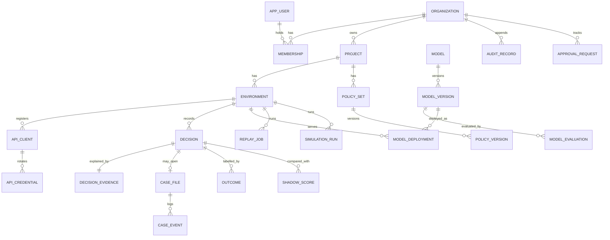

# VERDICT Architecture Context

Source of truth for system design. If code and this file disagree, either the code is wrong or this file needs an ADR. Baseline: V1.0 (draft pending owner approval).

## 1. Architecture at a glance

VERDICT has **six deployable units** and a small set of supporting systems. It avoids microservice sprawl: the control plane is one modular monolith, and a service is split out only when it needs independent scaling, failure isolation or a different runtime.

| Unit | Runtime | Why it is separate |
|---|---|---|
| `platform` | Java 25, Spring Boot | The control plane and the decision API. One deployable, many enforced modules |
| `stream` | Java 25, Kafka Streams | Event-time stream processing scales by partition and must keep running when the API is down |
| `model-service` | Python 3.13, FastAPI | The ML runtime stays in Python; it scales on CPU independently |
| `simulator` | Java 25 | Load generation must not share a process with the system under measurement |
| `console` | React and TypeScript, static build | Served from S3 and CloudFront (or a container locally) |
| `ml` | Python 3.13, batch jobs | Training and evaluation are jobs, not services |

Supporting systems: PostgreSQL (source of truth), Kafka (event backbone), Redis (rebuildable online store and rate limiter), S3 or MinIO (datasets, artifacts, exports), Keycloak (identity), MLflow (training side only), and the observability stack.

## 2. Stack

Pins are resolved at scaffold time (rule R-DEP in `ai-workflow-rules.md`). Versions marked "verified" were checked against the package registries on 12 Nov 2026. "Latest" does not mean compatible.

| Layer | Technology | Version baseline | Role |
|---|---|---|---|
| Backend language | Java | 25 LTS | All JVM services |
| ML language | Python | 3.13 (verified as the highest minor supported by every core ML dependency) | `model-service`, `ml` |
| Frontend language | TypeScript, strict mode | latest is 7.0.x; pin the newest version that satisfies all peer ranges | `console` |
| Control plane | Spring Boot: Spring MVC, Spring Security, Spring Data JPA, JDBC, Flyway, Actuator, Spring Session JDBC | 4.1.x | `platform` APIs, domain, rules, governance |
| Resilience | Resilience4j | verify Boot 4 compatibility at scaffold | Circuit breaker, bulkhead, time limiter on model and Redis calls |
| Event backbone | Apache Kafka, KRaft mode | broker 4.4.0; client library = Boot-managed | Events and stream processing |
| Stream processing | Kafka Streams | Boot-managed | `stream` feature topology |
| API contract | OpenAPI, generated by springdoc, checked in and diffed | resolve at scaffold | Machine and console API contract |
| Event contract | Protocol Buffers plus Buf (lint and breaking-change check) | resolve at scaffold | Event schemas and compatibility rules |
| JVM build | Gradle, Kotlin DSL, version catalog, wrapper | resolve at scaffold | Multi-module build |
| Serving | FastAPI, Pydantic, Uvicorn | 0.162.x, 2.14.x, 0.54.x (verified) | `model-service` |
| Modelling | XGBoost (champion family), scikit-learn (logistic baseline, calibration, metrics), LightGBM (comparator) | 3.4.x, 1.9.x, 4.7.x (verified) | Training and evaluation |
| Data processing | pandas, Polars, PyArrow | 3.1.x, 2.1.x, 26.x (verified) | pandas for sklearn interop and evaluation; Polars for heavy dataset preparation; Parquet as the interchange format |
| Experiment tracking | MLflow (tracking and artifacts; local and CI only) | 3.18.x (verified; smoke-test on Python 3.13) | Experiments, training artifacts |
| Data versioning | DVC | 3.67.x (verified) | Dataset pointers and hashes, reproducible pipelines |
| Drift analysis | Evidently | 0.7.x (verified) | Drift reports |
| ONNX path | onnxruntime, onnxmltools | 1.31.x, 1.16.x (verified) | Evaluated for in-JVM scoring (ADR-006) |
| Python quality | pytest, hypothesis, ruff, mypy, uv (lockfile) | 9.2.x, 6.170.x, 0.17.x, 2.4.x (verified); uv at scaffold | Tests, lint, types, reproducible environments |
| Transactional store | PostgreSQL | 17 (major pinned; confirm the RDS engine version at provisioning) | Source of truth |
| Online store | Redis | resolve at scaffold | Rebuildable feature materialization, rate limiting |
| Object storage | Amazon S3; MinIO locally | n/a | Datasets, model artifacts, exports |
| Identity | Keycloak (OIDC provider) | resolve at scaffold | Console sign-in, MFA, user lifecycle |
| Frontend core | React, Vite, @vitejs/plugin-react | 19.3.x, 8.3.x, 6.3.x (verified) | SPA |
| Routing and data | TanStack Router, Query, Table, Virtual | 1.170.x, 5.107.x, 9.3.x, 3.14.x (verified) | Type-safe routes with URL state, server state, tables, virtualization |
| Forms | React Hook Form, Zod | 7.92.x, 4.6.x (verified) | Forms and shared validation |
| UI | Tailwind CSS v4 with CSS-variable tokens, Radix UI primitives, own component layer | 4.3.x, 1.8.x (verified) | Accessible primitives, our own components |
| Charts and icons | Apache ECharts, Lucide | 6.1.x, 1.72.x (verified) | Data visualization, icons |
| Frontend quality | Storybook, Vitest, Testing Library, Playwright, axe-core, MSW, openapi-typescript, openapi-fetch, ESLint, Prettier | 10.6.x, 5.1.x, 16.3.x, 1.65.x, 4.14.x, 3.0.x, 7.13.x, 0.17.x, 10.14.x, 3.10.x (verified) | Component docs, tests, typed API client |
| Java quality | JUnit 5, AssertJ, Mockito, Testcontainers, ArchUnit, Awaitility, Spotless, JaCoCo | Boot-managed where possible | Tests, module-boundary checks, formatting |
| System testing | k6, Toxiproxy | resolve at scaffold | Load tests, fault injection |
| Observability | OpenTelemetry, Micrometer, Prometheus, Grafana, Tempo (local); CloudWatch (AWS) | resolve at scaffold | Metrics, traces, logs, dashboards |
| Infrastructure | Terraform; AWS: VPC, ALB, ECS Fargate, ECR, RDS, S3, Secrets Manager, KMS, CloudWatch, CloudFront, Route 53, ACM | resolve at scaffold | Reproducible cloud environments |
| Delivery | GitHub Actions with OIDC to AWS, CodeQL, Dependabot, dependency review, Trivy, Buf | n/a | CI/CD and supply-chain controls |

## 3. System boundaries

| Path | Owns | Must never |
|---|---|---|
| `services/platform` | Control plane, decision API, policy engine, governance, cases, replay control, audit, outbox relay | Run stream topologies or training |
| `services/stream` | Kafka Streams feature topology and the Redis materializer | Call platform APIs or write PostgreSQL |
| `services/model-service` | Inference, artifact loading and verification | Hold tenant state or read tenant tables |
| `services/simulator` | Seeded scenario generation and load | Touch the database or topics directly; it uses public APIs only |
| `ml/` | Dataset preparation, features, training, evaluation, drift reports, golden-fixture generation | Import code from `services/` |
| `web/console` | The React application | Hold secrets or call the machine API with credentials |
| `contracts/` | OpenAPI, Protobuf, feature spec, VPL JSON Schema, golden fixtures: the single source for cross-language contracts | Contain implementation code |
| `infra/` | Terraform, Docker Compose, observability configs, Keycloak realm export | Contain application logic |
| `docs/` | ADRs, runbooks, specs, reports | Contradict this file without an ADR |
| `benchmarks/` | k6 scripts, harness, raw results | Contain unmeasured numbers |

### Platform modules

Packages live under `dev.verdict.platform`. Modules interact only through their published interfaces and events. ArchUnit tests fail the build on a violation.

| Module | Owns (tables and responsibilities) | Depends on |
|---|---|---|
| `identity` | organizations, users, memberships, projects, environments, api_clients, api_credentials, sessions; RBAC evaluation | shared kernel |
| `decision` | decisions, decision_evidence, idempotency_records; request orchestration | policy, features, scoring, outbox, cases |
| `policy` | policy_sets, policy_versions; VPL parsing, validation, evaluation | shared kernel |
| `features` | feature_definitions (catalog); online-store reads, freshness evaluation | shared kernel |
| `scoring` | Model-service client, circuit breaker, fallback, shadow scoring | governance (deployments) |
| `governance` | models, model_versions, model_deployments, model_evaluations, approval_requests | audit |
| `cases` | cases, case_events, outcomes | decision (events) |
| `replay` | replay_jobs, replay_results | policy, scoring |
| `simulation` | simulation_runs; control of the simulator worker | identity |
| `audit` | audit_records (append-only, hash-chained) | shared kernel |
| `outbox` | outbox_events; the single-active relay | shared kernel |
| `insights` | SQL read models for Overview and Explorer | decision, cases (read) |
| `shared` | Ids (UUIDv7), injected Clock, error model, tenant context | nothing |

```mermaid
flowchart TB
    api["API layer: REST controllers, security filters"]
    subgraph modules["platform modules"]
        identity["identity&lt;br/&gt;orgs, RBAC, credentials, sessions"]
        decision["decision&lt;br/&gt;orchestration, idempotency, evidence"]
        policy["policy&lt;br/&gt;VPL, versions, evaluation"]
        features["features&lt;br/&gt;online reads, freshness"]
        scoring["scoring&lt;br/&gt;model client, breaker, fallback"]
        governance["governance&lt;br/&gt;models, deployments, approvals"]
        cases["cases and outcomes"]
        replay["replay"]
        simctl["simulation control"]
        audit["audit"]
        outbox["outbox relay"]
        insights["insights&lt;br/&gt;read models"]
    end
    kernel["shared kernel: ids, clock, errors, tenant context"]
    api --&gt; identity
    api --&gt; decision
    api --&gt; policy
    api --&gt; governance
    api --&gt; cases
    api --&gt; replay
    api --&gt; simctl
    api --&gt; insights
    decision --&gt; policy
    decision --&gt; features
    decision --&gt; scoring
    decision --&gt; outbox
    decision --&gt; cases
    replay --&gt; policy
    replay --&gt; scoring
    governance --&gt; audit
    policy --&gt; audit
    identity --&gt; audit
    modules --&gt; kernel
```

## 4. System context

```mermaid
flowchart TB
    client["Client systems&lt;br/&gt;(simulated payment platforms)"]
    dev["Integration engineer"]
    analyst["Risk analyst"]
    mm["Model manager"]
    admin["Org and platform admins, auditors"]
    subgraph verdict["VERDICT system boundary"]
        core["VERDICT platform"]
    end
    idp["Keycloak&lt;br/&gt;(OIDC identity provider)"]
    data["Public and synthetic datasets"]
    aws["AWS services"]
    gh["GitHub and Actions"]
    client --&gt;|"decision requests, outcomes"| core
    dev --&gt;|"credentials, docs, playground"| core
    analyst --&gt;|"cases, policies, replay"| core
    mm --&gt;|"models, promotion"| core
    admin --&gt;|"administration, audit"| core
    core --&gt;|"sign-in, token validation"| idp
    data --&gt;|"offline training and replay"| core
    core --&gt;|"hosting, storage, secrets"| aws
    gh --&gt;|"CI/CD via OIDC"| aws
```

**Trust boundaries.** (1) Internet to the load balancer: untrusted. (2) Console session boundary: cookie plus CSRF. (3) Machine API boundary: API credential. (4) Service-to-service: private network plus short-lived service tokens. (5) Data tier: reachable only from services. (6) CI to AWS: OIDC with a trust policy scoped to this repository.

## 5. Container architecture

```mermaid
flowchart LR
    subgraph clients["Clients"]
        browser["Browser&lt;br/&gt;React console"]
        api_client["API clients"]
    end
    subgraph app["Application services"]
        platform["platform&lt;br/&gt;Spring Boot modular monolith"]
        stream["stream&lt;br/&gt;Kafka Streams and materializer"]
        model["model-service&lt;br/&gt;FastAPI"]
        sim["simulator&lt;br/&gt;Java worker"]
    end
    subgraph data["Data and messaging"]
        pg[("PostgreSQL")]
        kafka[["Kafka"]]
        redis[("Redis")]
        s3[("S3 or MinIO")]
    end
    kc["Keycloak"]
    ml["ml pipelines&lt;br/&gt;Python batch jobs"]
    mlflow["MLflow&lt;br/&gt;training side only"]
    browser --&gt;|"HTTPS, session cookie"| platform
    api_client --&gt;|"HTTPS, API key"| platform
    sim --&gt;|"decisions, outcomes"| platform
    platform --&gt; pg
    platform --&gt;|"outbox relay"| kafka
    platform --&gt;|"read features"| redis
    platform --&gt;|"score over HTTP"| model
    platform --&gt;|"OIDC"| kc
    kafka --&gt; stream
    stream --&gt;|"feature updates"| kafka
    stream --&gt;|"version-guarded writes"| redis
    model --&gt;|"load artifacts"| s3
    ml --&gt;|"datasets, artifacts"| s3
    ml --&gt; mlflow
    ml --&gt;|"register version"| platform
```

## 6. Communication protocols

| From → to | Protocol and auth | Timeout and retry | Notes |
|---|---|---|---|
| Browser → platform | HTTPS JSON on `/console/v1`; session cookie plus CSRF token | Client 30 s; safe reads retried by TanStack Query | Same-origin in staging and prod; CORS only for the local dev origin |
| API client → platform | HTTPS JSON on `/v1`; `Authorization: Bearer &lt;api key&gt;` | Server deadline per request; clients retry with exponential backoff and jitter, reusing the same `Idempotency-Key` | No CORS: server-to-server only |
| platform → PostgreSQL | JDBC (HikariCP), TLS in AWS | Statement and lock timeouts set per path | Hot path uses explicit SQL |
| platform → Redis | RESP (Lettuce), password or ACL, TLS where available | Sub-budget of the request deadline; circuit breaker | Reads only on the decision path |
| platform → model-service | HTTP JSON; OAuth2 client-credentials service token (JWT) validated locally by the service | Timeout is the remaining scoring budget; no retry inside the budget; circuit breaker | Returns score, reasons, model version, artifact hash |
| platform → Kafka | Idempotent producer, `acks=all`; used only by the outbox relay | Retries with backoff | The decision path never calls Kafka directly |
| stream ↔ Kafka | Kafka protocol; `exactly_once_v2` | Streams-managed | Exactly-once applies inside Kafka only |
| stream → Redis | RESP; Lua compare-and-set script | Backoff with pause; Streams keeps running | A separate component from the topology |
| simulator → platform | Public `/v1` API with a sandbox API credential | As any client | Never bypasses the API |
| ml → platform | `/internal/v1` with an OIDC client-credentials token (role `ml-registrar`) | Retry with idempotent registration | Registers immutable model versions |
| model-service → S3 | AWS SDK, task role (cloud) or MinIO credentials (local) | Retry with backoff | Verifies SHA-256 before serving |
| Everything → collector | OTLP | Fire and forget | Trace context flows over HTTP and Kafka headers |
## 7. Decision path

### 7.1 Canonical request

`POST /v1/decisions` takes one canonical risk event. Required: `event_id` (client UUID, unique per environment), `event_type` (`TRANSACTION` in v1), `occurred_at` (RFC 3339 UTC), `subject` (`type`, `key`), `amount` (`value` as a decimal string, `currency` as ISO 4217). Optional: `counterparty`, `channel`, `attributes` (at most 32 scalar entries). No personal data fields exist in the schema.

- `occurred_at` must be at most 5 minutes in the future and at most 7 days in the past. Otherwise the response is `422 event_time_out_of_range`. Historical data enters through the simulator and replay paths.
- A repeated `event_id` under a different `Idempotency-Key` returns `409 event_already_decided` with the existing `decision_id`.
- The body is hashed as RFC 8785 canonical JSON, so whitespace and field order never cause false mismatches.

### 7.2 Sequence

```mermaid
sequenceDiagram
    autonumber
    participant C as Client
    participant P as platform
    participant DB as PostgreSQL
    participant R as Redis
    participant M as model-service
    C-&gt;&gt;P: POST /v1/decisions (API key, Idempotency-Key)
    P-&gt;&gt;P: Validate, authenticate, resolve tenant, rate limit
    P-&gt;&gt;DB: INSERT idempotency claim IN_PROGRESS, commit
    alt key already claimed
        DB--&gt;&gt;P: existing record
        P--&gt;&gt;C: replay stored response, or 409 in progress, or 422 payload mismatch
    else claim won
        P-&gt;&gt;R: read feature buckets and heartbeat
        R--&gt;&gt;P: features and freshness status
        P-&gt;&gt;P: evaluate active policy version
        P-&gt;&gt;M: score (features, model version, expected hash)
        M--&gt;&gt;P: score and reason codes
        P-&gt;&gt;DB: one transaction - decision, evidence, outbox rows, case if REVIEW, idempotency COMPLETED
        DB--&gt;&gt;P: commit
        P--&gt;&gt;C: 200 decision
    end
```

### 7.3 Policy and decision strategy

The active policy version is a VPL v1 document: typed conditions over request fields and features, ordered rules, score thresholds, a freshness policy and a failure mode. Precedence is fixed: a matching `DECLINE` rule wins, then a matching `REVIEW` rule, then the model thresholds (`score &gt;= decline_threshold` gives `DECLINE`, `score &gt;= review_threshold` gives `REVIEW`), otherwise `APPROVE`. An `ALLOW` rule can override model thresholds but never a `DECLINE` rule. Every fired rule and its inputs are recorded in the evidence. `fail_mode` is `OPEN_TO_RULES` (default in `SANDBOX`) or `CLOSED_TO_REVIEW` (default in `LIVE`).

### 7.4 Latency budget

The overall deadline defaults to 300 ms and is configurable per environment. Sub-budgets below are **design hypotheses** that Phase 21 calibrates against measurements.

| Stage | Budget (ms) |
|---|---|
| Parse, authenticate (cached credential), rate limit | 15 |
| Idempotency claim | 20 |
| Redis feature read | 15 |
| Policy evaluation | 10 |
| Model scoring (remote call timeout) | 100 |
| Persistence transaction (reserved first) | 60 |
| Serialize and respond | 10 |
| Slack | 70 |

Each stage's timeout is `min(stage budget, remaining deadline - reserved persistence budget)`. Persistence is reserved first, so slow upstream stages cannot starve the write.

## 8. Concurrent idempotency

**Scope.** The key is unique per `(tenant, environment, client, idempotency_key)`. `client` is the API client, which stays stable across credential rotation. Retention is 24 hours (`expires_at`); after that the key can be reused.

```sql
CREATE TABLE idempotency_records (
  tenant_id        uuid        NOT NULL,
  environment_id   uuid        NOT NULL,
  client_id        uuid        NOT NULL,
  idempotency_key  text        NOT NULL CHECK (length(idempotency_key) BETWEEN 1 AND 255),
  request_hash     bytea       NOT NULL,
  status           text        NOT NULL CHECK (status IN ('IN_PROGRESS','COMPLETED')),
  decision_id      uuid        NOT NULL,
  attempt          integer     NOT NULL DEFAULT 1,
  lease_expires_at timestamptz NOT NULL,
  response_status  smallint,
  response_body    jsonb,
  created_at       timestamptz NOT NULL DEFAULT now(),
  completed_at     timestamptz,
  expires_at       timestamptz NOT NULL,
  PRIMARY KEY (tenant_id, environment_id, client_id, idempotency_key)
);
CREATE INDEX idempotency_expiry_idx ON idempotency_records (expires_at);
```

**Protocol** (READ COMMITTED; the primary key serialises racing inserts, and `attempt` fences zombie owners):

1. Compute `request_hash` and allocate a new `decision_id` (UUIDv7).
2. **Claim**, in its own short transaction that commits immediately: `INSERT ... ON CONFLICT (tenant_id, environment_id, client_id, idempotency_key) DO NOTHING RETURNING decision_id`.
3. A row came back: this request is the owner (`attempt = 1`). Continue.
4. No row came back: read the existing record.
   - Hash differs: `422 idempotency_key_reused`.
   - `COMPLETED`: return the stored status and body with `Idempotent-Replayed: true`.
   - `IN_PROGRESS` with a valid lease: wait up to `min(remaining budget, 150 ms)` polling every 10–25 ms for `COMPLETED`; otherwise `409 request_in_progress` with `Retry-After: 1`.
   - `IN_PROGRESS` with an expired lease (the owner died): **take over** with a compare-and-set `UPDATE ... SET attempt = attempt + 1, lease_expires_at = now() + :lease WHERE &lt;pk&gt; AND status = 'IN_PROGRESS' AND lease_expires_at &lt; now() AND request_hash = :hash RETURNING decision_id, attempt`. The new owner reuses the stored `decision_id`. Zero rows means someone else won: re-read.
5. **Complete** inside the decision transaction: `UPDATE ... SET status = 'COMPLETED', response_status = :s, response_body = :b, completed_at = now() WHERE &lt;pk&gt; AND status = 'IN_PROGRESS' AND attempt = :myAttempt`. Zero rows means a newer attempt owns the key, so roll back the whole transaction, then re-read and replay.
6. Lease default: 5 s (configurable). Cleanup deletes expired records in batches.

**Why this is safe.** A lookup followed by an insert is a race; here the insert itself is the lock. A crash before commit leaves `IN_PROGRESS`, which a later request takes over after the lease. Decision evaluation has no external side effects, so re-running it is harmless. A zombie that wakes up after takeover cannot commit, because its `attempt` no longer matches.

**Tests** (Testcontainers PostgreSQL): 50 threads with one key and payload give one decision, one `DecisionMade` and one `RiskEventObserved` outbox row, and identical responses; same key with another payload gives 422; 1,000 keys raced concurrently give exactly 1,000 decisions; the owner killed after claim leads to takeover; a delayed zombie fails to commit.

## 9. Transactional outbox

In one transaction the platform writes: `decisions`, `decision_evidence`, the `case` (for `REVIEW`), the outbox rows (`RiskEventObserved` and `DecisionMade`) and the idempotency completion. Nothing publishes to Kafka inside the request.

```sql
CREATE TABLE outbox_events (
  id              bigint GENERATED ALWAYS AS IDENTITY PRIMARY KEY,
  event_id        uuid        NOT NULL UNIQUE,
  tenant_id       uuid        NOT NULL,
  topic           text        NOT NULL,
  partition_key   text        NOT NULL,
  event_type      text        NOT NULL,
  schema_version  integer     NOT NULL,
  payload         bytea       NOT NULL,
  headers         jsonb       NOT NULL DEFAULT '{}',
  created_at      timestamptz NOT NULL DEFAULT now(),
  status          text        NOT NULL DEFAULT 'PENDING' CHECK (status IN ('PENDING','PUBLISHED','DEAD')),
  attempts        integer     NOT NULL DEFAULT 0,
  next_attempt_at timestamptz NOT NULL DEFAULT now(),
  published_at    timestamptz
);
CREATE INDEX outbox_pending_idx ON outbox_events (id) WHERE status = 'PENDING';
```

```mermaid
sequenceDiagram
    autonumber
    participant D as decision transaction
    participant DB as PostgreSQL
    participant RL as outbox relay (single active)
    participant K as Kafka
    D-&gt;&gt;DB: INSERT decision and outbox rows in one commit
    loop every poll interval
        RL-&gt;&gt;DB: claim PENDING rows ordered by id (advisory lock held)
        RL-&gt;&gt;K: send batch (idempotent producer, acks=all)
        K--&gt;&gt;RL: acks
        RL-&gt;&gt;DB: mark PUBLISHED
    end
    Note over RL,K: Crash after ack and before mark causes a duplicate publish. Consumers dedupe on event_id.
    RL-&gt;&gt;DB: on failure - attempts plus one, backoff with jitter, DEAD after max attempts
```

- **Single active relay.** An advisory lock (`pg_try_advisory_lock`) elects one relay; it reads `PENDING` rows in `id` order and publishes with an idempotent producer. This preserves per-key order. It trades relay throughput for ordering simplicity (ADR-003).
- **Duplicates.** A crash between broker ack and the `PUBLISHED` update re-publishes. Consumers deduplicate on `event_id`.
- **Poison events.** After `max_attempts` (default 10) with exponential backoff and jitter, a row becomes `DEAD`, raises an alert and appears in an operator view. A dead event does not block other keys. For its own key, per-key ordering is knowingly broken; this is documented.
- **Cleanup.** `PUBLISHED` rows older than 7 days are deleted in batches.
- **Monitoring.** `verdict_outbox_pending`, `verdict_outbox_oldest_pending_age_seconds`, `verdict_outbox_dead_total`.

## 10. Failure design

`fail_mode` (from the active policy) is `OPEN_TO_RULES` or `CLOSED_TO_REVIEW`. The overall principle: **VERDICT never returns a decision it has not recorded** (ADR-017).

| # | Failure | Decision issued? | Behaviour | Review? | Recorded as | Recovery |
|---|---|---|---|---|---|---|
| 1 | Redis slow or down | Yes, degraded | Features unavailable: `OPEN_TO_RULES` evaluates rules only; `CLOSED_TO_REVIEW` returns `REVIEW` | By `fail_mode` | `degraded`, `FEATURES_UNAVAILABLE` | Circuit half-opens with backoff; resumes automatically |
| 2 | PostgreSQL unavailable | **No** | `503 decision_unavailable` with `Retry-After`; fails closed | n/a | Metric and alert | Pool reconnects; clients retry with the same key |
| 3 | Kafka unavailable | Yes | Unaffected; the outbox grows | No | Outbox age alert | Relay drains in order after recovery (AC-04) |
| 4 | Model-service timeout or 5xx | Yes, degraded | By `fail_mode` | By `fail_mode` | `MODEL_UNAVAILABLE` | Circuit half-open probes |
| 5 | Artifact unavailable or hash mismatch | Yes, degraded | As row 4; platform stops routing to that version | By `fail_mode` | `MODEL_ARTIFACT_INVALID` | Restore the artifact or roll back |
| 6 | Invalid model response (NaN, out of range, wrong version or hash) | Yes, degraded | Treated as a model failure and counted by the breaker | By `fail_mode` | `MODEL_RESPONSE_INVALID` | Fix or roll back the model |
| 7 | Features stale, lagging, invalid or from an old schema | Yes | Per policy `on_stale_features`: `DEGRADE_TO_RULES` (default), `REVIEW`, or `PROCEED_WITH_FLAG` | Policy-defined | `FEATURES_STALE` plus lag in the evidence | Heartbeat returns to fresh |
| 8 | Active policy cannot be loaded | Yes, if a last-known-good version is cached | Serve it, flagged `POLICY_FALLBACK`. With none cached the instance is not ready and returns 503 | No | Audit event and alert | Fix or roll back the policy |
| 9 | Concurrent duplicates | Yes | Replay the stored response, or `409` | No | Replay counter | None needed |
| 10 | Deadline exhausted | Maybe | Optional stages are skipped; persistence is reserved; if the commit misses the deadline the response is `504` and the retry replays or takes over | No | `deadline_exceeded` | Retry with the same key |
| 11 | Rate-limit store down | Yes | Per-instance in-memory buckets at a stricter limit | No | `RATE_LIMIT_DEGRADED` | Automatic |
| 12 | Keycloak down | Machine API: yes | Machine API is unaffected; console sign-in fails; existing sessions run to expiry | n/a | Alert | Restart the IdP |

```mermaid
flowchart TD
    start["Request received"] --&gt; pg{"PostgreSQL claim succeeds?"}
    pg --&gt;|"no"| r503["503 decision_unavailable&lt;br/&gt;no unrecorded decision"]
    pg --&gt;|"yes"| feat{"Features fresh?"}
    feat --&gt;|"yes"| pol["Evaluate policy"]
    feat --&gt;|"no"| fpol{"Policy on_stale and fail_mode"}
    fpol --&gt;|"degrade"| rules["Rules-only path, degraded=true"]
    fpol --&gt;|"review"| rev["Decision REVIEW, degraded=true"]
    pol --&gt; mdl{"Model score valid and within budget?"}
    mdl --&gt;|"yes"| combine["Combine policy and score"]
    mdl --&gt;|"no"| mfail{"fail_mode"}
    mfail --&gt;|"open to rules"| rules
    mfail --&gt;|"closed to review"| rev
    combine --&gt; persist
    rules --&gt; persist
    rev --&gt; persist
    persist["Persist decision, evidence, outbox, idempotency in one transaction"] --&gt; ok{"Commit within deadline?"}
    ok --&gt;|"yes"| resp["200 with decision"]
    ok --&gt;|"no"| r504["504, safe retry with the same key"]
```

## 11. Kafka delivery guarantees

| Hop | Guarantee | Mechanism | Residual risk and handling |
|---|---|---|---|
| API client → decision | Exactly-once **effect** | At-least-once retries plus idempotency keys | Key expiry after 24 h is documented |
| PostgreSQL → outbox → Kafka | At-least-once | Atomic outbox, idempotent producer, `acks=all` | Duplicates on relay crash: consumers dedupe on `event_id` |
| Kafka → Kafka Streams → Kafka | Exactly-once **within Kafka** | `processing.guarantee=exactly_once_v2`; single-node dev brokers need relaxed transaction-log replication settings | Applies only to read-process-write between topics and state stores |
| Kafka → Redis | At-least-once, **convergent** | Version-guarded idempotent Lua writes | Not exactly-once across systems: it converges to the right state, and replays are harmless |
| Kafka → platform projectors | At-least-once | Upsert keyed by `event_id` | Replays are harmless |

We do not claim end-to-end exactly-once across PostgreSQL, Kafka and Redis. We claim idempotent effects and convergent state, and each one has a test.

## 12. Event catalogue and compatibility

Default partitions: 6 (configurable). Replication factor 1 on single-node stacks, which is a documented limitation.

| Topic | Key | Value (Protobuf message) | Producer | Consumers | Semantics | Retention |
|---|---|---|---|---|---|---|
| `verdict.risk-events.v1` | `tenant\|env\|subject_key` | `RiskEventObserved` | Outbox relay (P1: `POST /v1/events`) | `stream` | At-least-once, dedupe by `event_id` | 7 d |
| `verdict.decisions.v1` | `tenant\|env\|subject_key` | `DecisionMade` | Outbox relay | Projectors (P1), archiver (P1), webhooks (P2) | At-least-once | 7 d |
| `verdict.outcomes.v1` | `tenant\|env\|decision_id` | `OutcomeRecorded` | Outbox relay | Evaluation and monitoring jobs | At-least-once | 30 d |
| `verdict.feature-updates.v1` | `tenant\|env\|subject_key\|resolution\|bucket_start` | `BucketAggregateUpdated` | `stream` (exactly-once within Kafka) | Materializer | Compacted | Compaction |
| `verdict.risk-events-late.v1` | As risk-events | `RiskEventObserved` plus lateness | `stream` | Analysis tools | At-least-once | 7 d |
| `verdict.governance-events.v1` | `tenant\|env` | `PolicyActivated`, `ModelPromoted`, `ModelRolledBack` | Outbox relay | Projectors (P1) | At-least-once | 30 d |
| `verdict.dlq.v1` | Original key | `DeadLetter` (original bytes, error, source) | Any consumer | Operators | Manual | 30 d |

**Envelope.** Kafka headers on every record: `event_id` (UUIDv7), `event_type`, `schema_version`, `tenant_id`, `traceparent`, `produced_at`.

**Compatibility rules (CI-enforced by `buf lint` and `buf breaking`).**
1. Only add optional fields, with new field numbers.
2. Never renumber, retype or reuse a field number. Reserve removed ones.
3. Enums only gain values; consumers must tolerate unknown values.
4. Consumers ignore unknown fields.
5. A breaking change creates a new package and topic (`v2`) with a dual-publish window and an ADR.
6. Schema files live in `contracts/events/`; generated code is never committed.
## 13. Streaming features and event time

### 13.1 Definitions

- **Event time:** `occurred_at`, supplied by the client and validated (see 7.1).
- **Processing time:** `received_at`, set by the platform.
- **Stream time:** the highest event time Kafka Streams has seen on a partition. It is derived from data, never from the wall clock, so replays are deterministic.
- **Grace period G:** 10 minutes by default (configurable). An event is **late** if `event_time &lt; stream_time - G`.
- **Amounts** are integer minor units in the environment's single configured currency. Another currency is rejected with `422 unsupported_currency`. FX conversion is a non-goal.

### 13.2 Pipeline

```mermaid
flowchart LR
    ob["Outbox relay"] --&gt; re[["risk-events.v1"]]
    re --&gt; dd["Deduplicate by event_id"]
    dd --&gt; lt{"Late beyond grace?"}
    lt --&gt;|"yes"| late[["risk-events-late.v1"]]
    lt --&gt;|"no"| agg["Aggregate 1-minute and 1-hour buckets&lt;br/&gt;event-time windows, EOS v2"]
    agg --&gt; fu[["feature-updates.v1 (compacted)"]]
    fu --&gt; mat["Materializer&lt;br/&gt;version-guarded Lua write"]
    mat --&gt; rd[("Redis")]
    mat --&gt; hb["Heartbeat per partition"]
    hb --&gt; rd
    dd -.-&gt;|"poison record"| dlq[["dlq.v1"]]
    agg -.-&gt;|"poison record"| dlq
```

### 13.3 Bucket model

Per subject, the topology keeps tumbling event-time buckets at two resolutions: **1 minute** (retained 2 h) and **1 hour** (retained 8 d). Each bucket stores `count`, `sum_minor`, `max_minor`, `last_event_time` and a monotonically increasing `version`. Every update re-emits the **full bucket** (not a delta) with a higher version, so a late event simply produces a corrected bucket that overwrites idempotently.

Initial feature set (the final list is frozen in `contracts/features/feature-spec-v1.yaml` in Phase 8): `txn_count_{5m,1h,24h,7d}`, `amount_sum_{1h,24h,7d}`, `amount_max_{24h,7d}`, `amount_ratio_to_mean_7d` (null when `count_7d` is 0), `seconds_since_last_event` (null when none in 7 d). Features needing non-mergeable state (distinct counts) are excluded from v1. Counterparty or category features are added only if the datasets support them.

### 13.4 Canonical window rule

For a decision on an event at time `t`, a window of size `W` over bucket size `B` includes every bucket whose start lies in `[floor_B(t) - (W - B), floor_B(t)]`, and the decided event itself is excluded. The effective span is therefore `(W - B, W]`. The 5 m and 1 h windows read 1-minute buckets; the 24 h and 7 d windows read 1-hour buckets. The offline Python implementation uses exactly the same bucket arithmetic, with the strict condition `event_time &lt; t`.

### 13.5 Late, duplicate and out-of-order events

| Case | Behaviour |
|---|---|
| Duplicate `event_id` | A windowed dedupe store (retention 1 h, configurable) drops it. Duplicates later than the retention are not detected; this is documented |
| Out of order, within G | Applied. The bucket version increments and the corrected bucket is re-emitted |
| Late beyond G | Routed to `risk-events-late.v1`, counted, and applied to **no** resolution, so the minute and hour views never disagree |
| Idle partition | No `suppress` operators are used. Updates are emitted eagerly, so nothing waits for stream time to advance |
| Replay | The same input order per partition reproduces the same aggregates |
| Poison record | Routed to `dlq.v1` with an error envelope |

### 13.6 Redis materialization

- **Key:** `v1:{tenant}:{env}:f:{subject_key}` (a hash). **Fields:** `m:{epoch_minute}` and `h:{epoch_hour}` with the compact value `version|count|sum_minor|max_minor|last_ts`.
- **Write:** an atomic Lua script sets a field only if the incoming `version` is greater than the stored one. Concurrent materializers, retries and replays cannot regress state.
- **Pruning and TTL:** the materializer deletes fields older than the retention on write. The key expires 8 days after its latest update.
- **Heartbeat:** a pipeline monitor in `stream` writes `v1:hb:{partition}` every second with `{caught_up, estimated_lag_ms, written_at_ms}`, computed from consumer-group lag on `risk-events` and `feature-updates`.
- **Redis is never a source of truth.** It can be rebuilt.
- **Rebuild:** (1) start `stream` with a new `application.id` suffix and a new materializer generation; (2) replay `risk-events` from the earliest offset (or from the S3 archive, P1); (3) the materializer writes keys under the new generation prefix; (4) when caught up and a parity sample passes, flip the single `online_store.generation` setting; (5) delete the old generation after a grace period. This is tested (AC-07).

### 13.7 Online and offline consistency

One canonical spec (`contracts/features/feature-spec-v1.yaml`) defines inputs, aggregation, windows, null semantics and tolerance. The Java implementation (stream topology plus the platform's derived-feature step) and the Python implementation (offline) both consume the **same golden fixtures** in `contracts/fixtures/golden/`: duplicates, late and out-of-order events, bucket-boundary timestamps, missing fields and silent subjects. The CI parity job diffs outputs: exact for integers, relative tolerance of 1e-9 for ratios. Changing a definition requires a new `feature_schema_version`.

**What parity does not cover.** Production freshness lag, and out-of-order bucket leakage of up to one 1-minute bucket, create training-serving skew. It is measured, not eliminated: the Feature Consistency Lab recomputes offline features for real decisions and compares them with the stored online snapshot.

```mermaid
flowchart LR
    spec["Canonical feature spec&lt;br/&gt;versioned, in contracts"] --&gt; java["Java implementation&lt;br/&gt;Kafka Streams buckets"]
    spec --&gt; py["Python implementation&lt;br/&gt;offline point-in-time features"]
    fx["Golden event fixtures"] --&gt; java
    fx --&gt; py
    java --&gt; parity{"CI parity gate"}
    py --&gt; parity
    parity --&gt;|"match"| online["Online store: Redis buckets"]
    parity --&gt;|"mismatch"| fail["Build fails"]
    py --&gt; train["Training datasets"]
    online --&gt; serve["Decision-time read and freshness check"]
    serve --&gt; snap["Feature snapshot stored with the decision"]
    snap --&gt; replay["Replay and audit"]
```

### 13.8 Freshness classification

| Status | Condition | Default action |
|---|---|---|
| `FRESH` | Heartbeat age at most 3 s and estimated lag at most 2 s | Proceed |
| `LAGGING` | Estimated lag within the policy's `max_lag_ms` (default 30 s) | Proceed, flagged in the evidence |
| `STALE` | Lag above `max_lag_ms`, or the heartbeat is missing | Policy `on_stale_features` |
| `EMPTY_FRESH` | The subject has no buckets and the pipeline is `FRESH` (a new subject) | Features computed as zero or null per the spec |
| `INVALID` | Decode error or `feature_schema_version` mismatch | Treated as `STALE`, counted |
| A single missing feature | Null per the spec | VPL conditions must handle null explicitly |

## 14. ML architecture

### 14.1 Datasets

Never committed to Git. Each is acquired by a script that respects its terms and is recorded in a hashed dataset manifest tracked with DVC. Column and entity claims below are **expected from documentation and must be confirmed by the Phase 9 data audit (DA-001)**; no field is assumed to exist until then.

| Dataset | Licence and access (as researched) | Rows (recount at ingestion) | Role in VERDICT | Entity and time (to confirm) |
|---|---|---|---|---|
| Sparkov synthetic transactions | CC0, per the Amazon Fraud Dataset Benchmark description | 1,316,675 in the benchmark table | **Primary**: streaming and velocity features, sequence experiment | Expected to carry a card identifier and real timestamps |
| IEEE-CIS Fraud Detection | Kaggle competition rules not retrieved; treat as restricted, never redistribute, download through the Kaggle API after you accept the rules | 589,540 in the benchmark table (its description says 590,540) | **Secondary**: offline tabular benchmark | No clean entity ID; any pseudo-entity is a documented heuristic; time is an offset |
| ULB credit-card dataset | DbCL 1.0 | 284,807 | **Baseline sanity check** | Anonymised PCA features, no entity IDs, time offset: no velocity features |

Three tracks stay separate: **A** public-dataset offline evaluation; **B** synthetic event-stream simulation (dataset events rebased into the last 7 days with relative gaps preserved, replay slices of at most 7 days); **C** simulated delayed feedback. No simulated outcome is ever presented as a real fraud or chargeback label.

### 14.2 Evaluation protocol

| Topic | Rule |
|---|---|
| Splits | Time-ordered train, validation, calibration and test, with a gap at least as long as the label-maturation window. No random splits |
| Baselines | Rules only, logistic regression, XGBoost (champion family), LightGBM (comparator) |
| Primary metrics | PR-AUC; recall at fixed false-positive rates (for example 1% and 0.1%); precision at review capacity K%; expected cost under an **assumed** cost matrix, with a sensitivity sweep |
| Secondary metrics | ROC-AUC, Brier score, reliability curves, expected calibration error, confusion matrices at chosen thresholds, sliced error analysis |
| Uncertainty | Block bootstrap over days |
| Imbalance | Compare class weighting, `scale_pos_weight`, undersampling and none, and report the effect. No synthetic oversampling of time series without justification |
| Calibration | Isotonic or Platt scaling fitted on the calibration slice only |
| Ablation | By feature group: amount, time, velocity, recency |
| Leakage controls | Point-in-time features only; forbidden-column lists; a shuffled-label test must score near the base rate; a poison test fails if any training feature uses events at or after `t`; entity-overlap analysis between splits |
| Reproducibility | Seeded runs; dataset manifest hash and locked environment recorded in MLflow; `make train` reproduces metrics within a stated tolerance |

### 14.3 Delayed labels

Outcomes arrive as `OutcomeRecorded` events with their own timestamps. A label is `PENDING` until it matures (after the maturity window, or earlier on explicit confirmation). Evaluation uses cohorts by decision time and includes only matured ones. Simulated delays follow a configurable distribution and are tagged `SIMULATED`.

### 14.4 Model lifecycle

```mermaid
stateDiagram-v2
    [*] --&gt; Trained
    Trained --&gt; Registered: immutable artifact and SHA-256
    Registered --&gt; Evaluated: offline gates pass
    Registered --&gt; Rejected: gates fail
    Evaluated --&gt; Shadow: challenger deployed
    Shadow --&gt; PromotionRequested: shadow evidence reviewed
    PromotionRequested --&gt; Champion: second approver approves
    PromotionRequested --&gt; Shadow: rejected
    Champion --&gt; Retired: replaced by a new champion
    Champion --&gt; RolledBack: rollback in one action
    Retired --&gt; [*]
    RolledBack --&gt; [*]
    Rejected --&gt; [*]
```

**Offline gates** (thresholds are policy parameters, not claims): PR-AUC not worse than the champion on the same test set (with confidence interval); calibration within bound; recall at the fixed FPR not worse; the feature parity test passes; model-service latency within the scoring budget; artifact hash, dataset manifest and feature schema version recorded.

### 14.5 Serving contract (`model-service`)

- `POST /internal/v1/score` takes `{model_version_id, expected_sha256, feature_schema_version, features, explain}` and returns `{model_version_id, artifact_sha256, score, reason_codes[{code, contribution}], latency_ms}`.
- Artifacts load lazily from S3 or MinIO and are verified by SHA-256. A mismatch or unsupported `feature_schema_version` returns `409`. Readiness requires the champion to be loaded.
- Pydantic strict models forbid extra fields; NaN is treated as missing. `GET /health/live` and `GET /health/ready` exist.
- Reason codes come from XGBoost's native per-prediction contributions, mapped through `reason-code-map.yaml`. If an ONNX path is chosen (ADR-006), the reason-code path must be re-evaluated.
- Shadow scoring uses the same endpoint with another `model_version_id`, called asynchronously and droppable under load.

### 14.6 Governance

The platform database owns lifecycle state (ADR-012). MLflow holds experiments and training artifacts only. The `ml` pipeline registers an immutable `model_version` through `/internal/v1` with its artifact SHA-256, feature schema version, dataset manifest hash, metrics and evaluation report. `model_deployments` records each environment's champion and shadows. Promotion is one transaction: it flips the champion, writes the audit record and the outbox event. Before routing traffic, the platform asks the model service for the version's hash and requires a match.

### 14.7 Drift and monitoring

Evidently jobs compute PSI and KS for features and for the prediction distribution against the training reference. These are **indicators**: a drift alert asks a human to look. A performance-degradation alert comes only from matured-label cohorts with a minimum sample size, using rolling PR-AUC and recall at fixed FPR with confidence intervals.

### 14.8 Replay determinism

Evidence stores the input event, feature snapshot, feature schema version, policy version, model version and hash, thresholds and decision time. Replay re-evaluates the policy and re-scores the **stored snapshot**. It reproduces the original decision exactly when the artifact still exists and scoring is deterministic. Documented sources of non-determinism: a missing or rotated artifact, floating-point differences across library versions, and configuration changes such as `fail_mode`. VPL has no wall-clock access. Mismatches are categorised in the replay report.

### 14.9 Where optional AI attaches

The sequence-model challenger (P2) is just another artifact behind the same scoring contract. The investigation assistant (P2) is a separate module off the decision path with read-only access to evidence and no write privilege on decisions, policies or models.
## 15. Storage model

| Store | Holds | Owner | Consistency and notes |
|---|---|---|---|
| PostgreSQL 17 (`verdict` database) | Identity, credentials (hashes), idempotency, decisions and evidence, outbox, cases, outcomes, policies, models and deployments, replay and simulation runs, audit, approvals, sessions, saved views | `platform` modules (see section 3) | Source of truth. Single primary. READ COMMITTED. Explicit SQL on the hot path, JPA for control-plane CRUD (ADR-015) |
| PostgreSQL (`keycloak` database) | Keycloak's own state | Keycloak | Separate database and role, same instance |
| Redis | Online feature buckets, heartbeats, rate-limit buckets | `stream` (writes), `platform` (reads) | Rebuildable materialization. Never a source of truth |
| Kafka | Events in transit and short-term history | Producers per section 12 | Not the source of truth for decisions |
| S3 (MinIO locally) | Dataset snapshots (Parquet), immutable model artifacts, replay reports, exports, optional event archive (P1) | `ml`, `platform` | Versioning on, SSE-KMS in AWS. Artifact keys embed the SHA-256 |
| MLflow (local and CI only) | Experiments, training artifacts | `ml` | Training side only. Lifecycle state lives in PostgreSQL (ADR-012) |
| ClickHouse | **Not used** | n/a | Revisit only if measured analytical queries exceed their targets on PostgreSQL |

**Database roles.** `verdict_owner` owns objects and runs Flyway, never at runtime. `verdict_app` is the runtime role: DML grants only, `NOBYPASSRLS`, not an owner. `verdict_worker` serves the outbox relay and cleanup jobs under dedicated policies on only the tables they need. Replay jobs read decisions and evidence through the tenant-scoped path and write only to replay tables.

## 16. Data model



**Conventions** (full rules in `code-standards.md`): `snake_case`, plural table names; UUIDv7 primary keys; `timestamptz` in UTC; every tenant-scoped table has `tenant_id uuid NOT NULL`; foreign keys always indexed; JSONB only for evidence and documents that are read whole; enums as `text` with `CHECK`.

| Entity | Key columns and constraints | Indexes | Lifecycle and retention |
|---|---|---|---|
| `organizations` | `id`, unique `slug`, `status` | slug | Soft delete, purge after 30 d |
| `app_users` | `id`, unique `oidc_subject`, `email`, `status` | subject | Platform-wide (not tenant-scoped); access only through memberships |
| `memberships` | unique `(organization_id, user_id)`, `role`, `status` | user_id | Role changes audited |
| `projects` | `organization_id` FK, unique `(organization_id, name)` | org | Until deleted |
| `environments` | `project_id` FK, `tenant_id`, `kind` (`SANDBOX`, `LIVE`), `currency`, `fail_mode`, `active_policy_version_id`, unique `(project_id, name)` | project | Until deleted |
| `api_clients` | `environment_id` FK, `name`, `status` | environment | Stable across rotations |
| `api_credentials` | `client_id` FK, unique `key_id`, `secret_hash`, `scopes`, `expires_at`, `revoked_at`, `last_used_at` | key_id | Expired or revoked rows kept for audit |
| `idempotency_records` | PK in section 8 | `expires_at` | 24 h |
| `decisions` | `id`, `tenant_id`, `environment_id`, `client_id`, `event_id`, `subject_key`, `decision`, `risk_score`, `reason_codes`, `policy_version_id`, `model_version_id`, `degraded`, `degradation_reasons`, `latency_ms`, `trace_id`, `decided_at`; unique `(tenant_id, environment_id, event_id)` | `(tenant, env, decided_at desc, id desc)` for keyset paging; `(tenant, env, subject_key, decided_at desc)` for the entity timeline | 90 d default, batched deletes. Not partitioned in v1, because uniqueness on `event_id` is simpler without partitions (ADR-020) |
| `decision_evidence` | `decision_id` PK and FK; JSONB: `request`, `features`, `freshness`, `rules_fired`, `model_info`, `thresholds`, `timings`; `feature_schema_version` | PK | Same as `decisions` |
| `outbox_events` | Section 9 | Pending partial index | 7 d after publish |
| `cases` | unique `decision_id`, `state`, `assignee_id`, `resolution`, `priority`, `opened_at`, `due_at` | `(tenant, env, state, opened_at)`, assignee | 1 year |
| `case_events` | `case_id` FK, `type` (`NOTE`, `STATE_CHANGE`, `ASSIGNMENT`), `actor_id`, `body` | case_id | Append-only, with the case |
| `outcomes` | unique `(tenant, env, outcome_id)`, `decision_id` FK, `label`, `source`, `occurred_at`, `recorded_at`, `matured_at` | decision_id, `(tenant, env, occurred_at)` | 1 year |
| `policy_sets`, `policy_versions` | unique `(policy_set_id, version)`, `status`, `document` (JSONB), `document_sha256`, `author_id`, `approved_by` | set | Versions never deleted. A trigger forbids changing `document` after `VALIDATED` |
| `feature_definitions` | `schema_version`, `name`, `spec` | schema_version | Global, versioned, never deleted |
| `models`, `model_versions` | `mlflow_run_id`, `artifact_uri`, `artifact_sha256`, `feature_schema_version`, `dataset_manifest_sha256`, `metrics`, `status` | model | Immutable except `status` |
| `model_deployments` | `environment_id`, `model_version_id`, `role` (`CHAMPION`, `SHADOW`), `since`, `ended_at`; partial unique index: one active champion per environment | environment | Kept as history |
| `model_evaluations` | `model_version_id`, `kind` (`OFFLINE`, `SHADOW`, `MATURED_LABELS`), `window`, `metrics`, `report_uri` | version | Kept |
| `shadow_scores` | PK `(decision_id, model_version_id)`, `score`, `agreed`, `latency_ms` | decision | 30 d |
| `approval_requests` | `kind`, `subject_id`, `requested_by`, `decided_by`, `status`; `CHECK (decided_by IS DISTINCT FROM requested_by)` | subject | Kept |
| `replay_jobs`, `replay_results` | Job config, status, summary; per-decision differences | job | 30 d |
| `simulation_runs` | `scenario`, `seed`, `config`, `status` | environment | Kept |
| `audit_records` | Below | `(tenant, seq)` | Append-only, not deleted in v1 |
| `saved_views` (P1) | `user_id`, `scope`, `filters` | user | Until deleted |
| Spring Session tables | Managed by Spring Session JDBC | expiry | Per session timeout |

### Audit chain

```sql
CREATE TABLE audit_records (
  id            bigint GENERATED ALWAYS AS IDENTITY PRIMARY KEY,
  tenant_id     uuid        NOT NULL,
  seq           bigint      NOT NULL,
  occurred_at   timestamptz NOT NULL DEFAULT now(),
  actor_type    text        NOT NULL,
  actor_id      uuid,
  action        text        NOT NULL,
  resource_type text        NOT NULL,
  resource_id   text        NOT NULL,
  details       jsonb       NOT NULL DEFAULT '{}',
  prev_hash     bytea       NOT NULL,
  record_hash   bytea       NOT NULL,
  UNIQUE (tenant_id, seq)
);
```

`record_hash = SHA-256(canonical JSON of the record fields || prev_hash)`. A per-tenant head row (`audit_chain_heads`) is locked with `SELECT ... FOR UPDATE` inside the same transaction as the audited change, which serialises appends. `verdict_app` has `INSERT` on records and no `UPDATE` or `DELETE`. A verification job recomputes the chain. **This is tamper-evident, not tamper-proof:** someone with owner rights could rewrite the whole chain, so a daily chain-head checkpoint is exported to versioned S3 (P1).

### Row-level security

```sql
ALTER TABLE decisions ENABLE ROW LEVEL SECURITY;
ALTER TABLE decisions FORCE ROW LEVEL SECURITY;
CREATE POLICY tenant_isolation ON decisions
  USING      (tenant_id = NULLIF(current_setting('app.tenant_id', true), '')::uuid)
  WITH CHECK (tenant_id = NULLIF(current_setting('app.tenant_id', true), '')::uuid);
```

The tenant is set per transaction with `SELECT set_config('app.tenant_id', :tenant, true)` (transaction-local). If it is unset, the comparison is `NULL` and **no rows match**: the system fails closed. Every tenant-scoped table has an equivalent policy, enforced by a migration test that lists tables with a `tenant_id` column and fails if any lacks RLS.

### Retention defaults

| Item | Default | Mechanism |
|---|---|---|
| Idempotency records | 24 h | Batched delete job |
| Published outbox rows | 7 d | Batched delete job |
| Decisions and evidence | 90 d, configurable per environment | Batched delete job |
| Shadow scores, replay results | 30 d | Batched delete job |
| Cases, outcomes | 1 year | Batched delete job |
| Audit records | Not deleted in v1 | n/a |
| Exports | 7 d | S3 lifecycle rule |
| Kafka topics | Section 12 | Topic configuration |
| Redis keys | 8 d sliding TTL | Redis expiry |

## 17. Tenancy and isolation layers

Never trust a tenant ID from the frontend as proof of authorization.

| # | Layer | Mechanism |
|---|---|---|
| 1 | Identity resolution | Console: the verified session maps to memberships; the requested organization (`X-Verdict-Org`) is **checked** against them. Machine API: credential to client to environment to tenant |
| 2 | Application | Every repository method takes a tenant context from the request scope; queries filter by it |
| 3 | Database | Forced RLS on every tenant-scoped table, keyed to the transaction-local setting |
| 4 | Kafka | `tenant` is part of every key and header; consumers verify it before applying |
| 5 | Redis | Tenant and environment are part of every key prefix |
| 6 | S3 | Tenant prefix per export; presigned URLs are short-lived and tenant-scoped |
| 7 | Model service | Stateless: it receives features and nothing tenant-identifying beyond the model version |

The `PLATFORM_ADMIN` path uses a separate connection pool and database role that can read only `organizations` and platform health tables. It cannot read decisions.

## 18. Backup and recovery

| Component | Strategy | Notes |
|---|---|---|
| PostgreSQL | RDS automated backups with point-in-time recovery (retention set in Terraform), a manual snapshot before each staging migration | A restore drill is run once before V1.0, and measured RTO and RPO are published. No figures are claimed before that |
| Redis | Rebuild from Kafka (section 13.6) | RTO equals replay time, which is measured |
| Kafka | Not a source of truth. Retention covers short outages | A re-emit job (P1) regenerates events from `decisions` after retention |
| S3 | Versioning on, artifact keys immutable | Model artifacts and dataset snapshots are recoverable |
| Terraform state | Remote, versioned, locked | Stack recreation from code is part of acceptance (AC-22) |
| Migrations | Forward-only, backward-compatible (expand, then contract) | A rollback means redeploying the previous app version, which still works with the expanded schema |
## 19. Authentication, authorization and security

### 19.1 Console identity: OIDC with a backend-for-frontend

Keycloak is the OIDC provider. The platform is a **confidential OIDC client** (authorization code with PKCE). **The browser never holds tokens**: it holds only an `HttpOnly` session cookie (ADR-008).

```mermaid
sequenceDiagram
    autonumber
    participant B as Browser SPA
    participant P as platform BFF
    participant K as Keycloak
    B-&gt;&gt;P: GET /console/v1/session
    P--&gt;&gt;B: 401 no session
    B-&gt;&gt;P: GET /oauth2/authorization/keycloak
    P--&gt;&gt;B: 302 to Keycloak (authorization code with PKCE)
    B-&gt;&gt;K: login and MFA
    K--&gt;&gt;B: 302 back with code
    B-&gt;&gt;P: GET callback with code
    P-&gt;&gt;K: exchange code over the back channel
    K--&gt;&gt;P: ID token and tokens
    P-&gt;&gt;P: create server session, resolve user and memberships
    P--&gt;&gt;B: Set-Cookie session (HttpOnly, Secure, SameSite), 302 to SPA
    B-&gt;&gt;P: API call with cookie and X-XSRF-TOKEN
    P-&gt;&gt;P: verify session, CSRF, org membership, permission
    P--&gt;&gt;B: response
    K--&gt;&gt;P: back-channel logout on revocation
    P-&gt;&gt;P: invalidate matching sessions
```

| Topic | Decision |
|---|---|
| Sessions | Spring Session JDBC (PostgreSQL). Cookie `__Host-verdict_session` in staging and production (plain name on local HTTP). `HttpOnly`, `Secure`, `SameSite=Lax` |
| Lifetime | Idle 30 min, absolute 8 h (both configurable). No refresh tokens in v1: IdP-side disablement takes effect through back-channel logout or at session expiry, a documented trade-off |
| Sign-out | `POST /console/v1/session/logout` deletes the server session and performs RP-initiated logout. The back-channel logout endpoint invalidates sessions by `sid` or `sub` |
| CSRF | `XSRF-TOKEN` cookie plus `X-XSRF-TOKEN` header on all non-safe methods, plus an `Origin` check. The exact Spring Security SPA handler is verified against current docs in Phase 4 |
| MFA | Keycloak TOTP. Required for `ORG_ADMIN` and `MODEL_MANAGER`. Step-up before approvals is P1 |
| Account lifecycle | Email verification, password recovery and brute-force detection come from Keycloak. Mail goes to Mailpit locally; in AWS staging, email flows are enabled only if an SMTP provider is configured, otherwise demo accounts are pre-provisioned (a documented limitation) |
| Provisioning | The first login creates an `app_users` row with no memberships. `ORG_ADMIN` invites by email; the membership activates at a login with `email_verified = true` and the same address |
| Auth rate limits | Per-IP limits on `/oauth2/*` and session endpoints (Redis); Keycloak's brute-force protection on the IdP side |
| Realm | Exported to `infra/keycloak/` and imported on startup |

### 19.2 Machine identity: API credentials

- **Format:** `vk_{env}_{key_id}_{secret}`, where `env` is `sbx` or `live`, `key_id` is a 12-character public identifier and `secret` is 32 random bytes (base64url).
- **Storage:** `secret_hash = HMAC-SHA-256(pepper, secret)`. The pepper lives in Secrets Manager. The lookup is by `key_id` (indexed), then a constant-time comparison. A slow password KDF is deliberately **not** used: the secret is 256-bit random, and a KDF would cost hot-path latency for no security gain.
- **One-time display:** the secret is returned once at creation and is never retrievable.
- **Lifetime:** expires after 90 days by default (maximum 1 year). **Rotation** creates a new credential under the same client, and the old one stays valid until its expiry or revocation. **Revocation** is immediate in the database; the in-process credential cache (at most 30 s) bounds propagation, a documented limit.
- **Scopes:** `decisions:write`, `decisions:read`, `outcomes:write`, `events:write` (P1). A credential is bound to one environment.
- **Failures:** a generic `401` that does not reveal whether a `key_id` exists. `last_used_at` is updated asynchronously in batches, never on the hot path.
- **Audit:** creation, rotation, revocation and bursts of failures.
- **Playground:** the Developer Portal playground calls the API server-side through the BFF with a managed sandbox credential. The browser never sees a secret.

### 19.3 Service identity

OAuth2 client credentials from Keycloak: `platform-svc` calls `model-service`; `ml-registrar` calls `/internal/v1`. Each service validates the JWT locally (issuer, audience, expiry, scope) using cached JWKS. There is no per-request introspection.

### 19.4 Authorization (RBAC)

Permissions are named `resource:action`. The role-to-permission map lives in one class and is mirrored by the authorization-matrix test (AC-14). Key: **R** read, **W** write, **A** approve, **X** execute, **—** none. Approval requires the approver to differ from the requester (a database `CHECK` plus a service check).

| Resource and action | `PLATFORM_ADMIN` | `ORG_ADMIN` | `RISK_ANALYST` | `MODEL_MANAGER` | `DEVELOPER` | `AUDITOR` |
|---|---|---|---|---|---|---|
| Tenants: create, suspend; platform health | W | — | — | — | — | — |
| Organization settings, members, roles | — | W | R | R | R | R |
| Projects and environments | — | W | R | R | R | R |
| API clients and credentials | — | W | — | — | W (`SANDBOX` only) | R (metadata) |
| Decisions: search and view | — | R | R | R | R (`SANDBOX` only) | R |
| Cases: work, assign, resolve | — | R | W | R | — | R |
| Outcomes: record | — | — | W | — | W (API scope) | R |
| Policies: draft, edit, test, dry-run, submit | — | — | W | W | — | R |
| Policies: approve, activate, roll back | — | A | — | — | — | R |
| Models: register, evaluate, shadow, request promotion | — | — | — | W | — | R |
| Models: approve promotion | — | A | — | — | — | R |
| Models: roll back | — | X | — | X | — | R |
| Replay and dry-run jobs | — | — | W | W | — | R |
| Simulation runs | — | — | — | W | W (`SANDBOX` only) | R |
| Feature platform views | — | R | R | R | R | R |
| Audit log: view, verify | — | R | — | — | — | R |
| Exports (authorised, audited) | — | W | W (cases) | — | — | W |
| Security settings (MFA, session lifetime) | — | W | — | — | — | R |

`PLATFORM_ADMIN` has no access to tenant decision data. The UI hides actions a role cannot perform, but the server enforces every one.

### 19.5 CORS, headers, TLS, secrets, IAM

- **CORS** (console API only; `/v1/**` is server-to-server and sends no CORS headers). Local: allow `http://localhost:5173`. Staging and production are same-origin through CloudFront, so the default allowlist is empty; any extra first-party origin must be listed explicitly. Never `*` with credentials: startup validation fails fast on that combination. Methods `GET, POST, PUT, PATCH, DELETE, OPTIONS`. Request headers `Content-Type, X-XSRF-TOKEN, X-Verdict-Org, Idempotency-Key, traceparent`. Exposed headers `X-Request-Id, Retry-After, Idempotent-Replayed`. `Access-Control-Allow-Credentials: true`, `Access-Control-Max-Age: 600`, `Vary: Origin`. Preflight is answered without authentication. A disallowed origin gets no `Access-Control-Allow-Origin` header.
- **Headers:** HSTS (staging and production), `X-Content-Type-Options: nosniff`, `Referrer-Policy: strict-origin-when-cross-origin`, `Cache-Control: no-store` on API responses, a minimal `Permissions-Policy`, and a CSP with `frame-ancestors 'none'` and no `unsafe-eval`, deployed in report-only mode first and then enforced.
- **TLS:** terminated at CloudFront and the ALB with ACM certificates (final milestone, on a registered domain; earlier ephemeral stacks may use HTTP on synthetic data only). RDS requires TLS. Redis TLS is evaluated in Phase 20, and the gap is documented if not enabled.
- **Secrets:** AWS Secrets Manager injected as ECS task secrets, encrypted with KMS. Locally, an untracked `.env` with a committed `.env.example`. Secret scanning with push protection, plus a pre-commit scanner.
- **IAM:** separate task roles per service (`platform`: its S3 prefixes and its secrets; `model-service`: read-only on artifacts; `stream`: no data permissions beyond logs). The GitHub OIDC trust policy is restricted to this repository and its protected environments. The deploy role can update only the named ECS services and push only to the named ECR repositories. Terraform has its own role.

### 19.6 Threat model

| ID | Threat | Controls | Verified by |
|---|---|---|---|
| T1 | Cross-tenant data access (broken object-level authorization) | Tenant from verified identity, application filters, forced RLS, Kafka and Redis namespacing | ST-01, ST-02 |
| T2 | API key theft or leak | Hashed storage, one-time display, scopes, environment binding, expiry, rotation, secret scanning, rate limits | ST-04, ST-15 |
| T3 | Replay or duplicate abuse | Idempotency scope, TLS, timestamp bounds, `event_id` uniqueness | AC-01, AC-02 |
| T4 | Malicious policy content | VPL is non-Turing-complete data, schema validated, maker-checker approval | ST-12 |
| T5 | Model artifact tampering | SHA-256 verification at load, immutable S3 keys, hash check before routing | AC-10, ST-13 |
| T6 | Session hijack, CSRF, XSS | `HttpOnly` cookies, `SameSite`, CSRF tokens, `Origin` check, CSP, no tokens in JavaScript, output encoding | ST-05, ST-06, ST-09 |
| T7 | SSRF | No user-supplied URL fetches in v1. Webhooks (P2) require an egress allowlist and DNS-rebinding protection before they ship | Design review |
| T8 | SQL injection | Parameterised queries only, RLS as a backstop, injection test corpus | ST-09 |
| T9 | Audit tampering | Hash chain, insert-only grants, exported chain-head checkpoints (P1) | AC-24, ST-11 |
| T10 | Denial of service or noisy neighbour | Per-client rate limits, bulkheads, deadlines, body-size limits | ST-10, AC-08 |
| T11 | Supply-chain compromise | Dependabot, dependency review, actions pinned to commit SHAs, Trivy, minimal images, SBOM (P1) | ST-14 |
| T12 | Secrets in logs or Git | Redaction filters, no payload logging at INFO, secret scanning | ST-15 |
| T13 | Privilege escalation by role change | Maker-checker for governance, last-admin protection, audited role changes | ST-03 |

### 19.7 Security acceptance tests

ST-01 tenant isolation at the API layer and with application filters disabled (RLS alone). ST-02 object-ID tampering across tenants. ST-03 the full role matrix, allowed and denied. ST-04 credential lifecycle: one-time display, hashed storage, expiry, rotation overlap, revocation within the cache bound. ST-05 sessions: fixation, logout, back-channel logout, idle and absolute timeouts. ST-06 CSRF: missing, wrong and cross-origin tokens rejected. ST-07 CORS matrix including preflight and a disallowed origin. ST-08 headers and CSP. ST-09 injection and XSS corpora on every search, filter and notes field. ST-10 rate limits on credentials and auth endpoints. ST-11 audit tamper detection. ST-12 malicious VPL is rejected and nothing executes. ST-13 tampered artifact is refused. ST-14 no unresolved high or critical findings in dependency and container scans. ST-15 no secrets in the repository or logs.

## 20. API catalogue

The authoritative contract is `contracts/openapi/verdict-v1.yaml`, authored and reviewed in Phase 0. This is the catalogue it must implement.

**Rules for all APIs.** Errors use RFC 9457 `application/problem+json` with `type`, `title`, `status`, `detail`, `instance`, `code`, `request_id`, `errors[]`. Lists use **keyset pagination** (`limit`, `cursor`), `sort` such as `-decided_at`, and explicit filter parameters. Every response carries `X-Request-Id` and honours `traceparent`. Rate-limit responses are `429` with `Retry-After` and `X-RateLimit-*` headers. Request bodies are limited (64 KB for decisions). `/v1` and `/console/v1` are versioned in the path; breaking changes need a new version and an ADR.

### Machine API (`/v1`, API credential)

| Endpoint | Scope | Idempotency | Purpose |
|---|---|---|---|
| `POST /v1/decisions` | `decisions:write` | `Idempotency-Key` required | Decide on one event |
| `GET /v1/decisions/{id}` | `decisions:read` | n/a | Retrieve a decision |
| `POST /v1/outcomes` | `outcomes:write` | By `outcome_id` | Record a label |
| `POST /v1/events` (P1) | `events:write` | By `event_id` | Ingest an observe-only event |

### Console API (`/console/v1`, session cookie plus CSRF, permissions per section 19.4)

| Group | Endpoints |
|---|---|
| Session and profile | `GET /session`, `POST /session/logout`, `GET /me`, `GET /organizations` |
| Administration | `GET, PATCH /orgs/{org}`; `GET, POST, PATCH /orgs/{org}/members`; `GET, POST /projects`; `GET, POST /projects/{p}/environments`; `PATCH /environments/{e}` |
| Credentials | `GET, POST /environments/{e}/api-clients`; `POST /api-clients/{c}/credentials` (secret returned once); `POST /credentials/{id}/revoke` |
| Decisions | `GET /decisions` (filters, keyset); `GET /decisions/{id}`; `GET /decisions/{id}/evidence`; `GET /subjects/{key}/timeline` (P1) |
| Cases | `GET /cases`; `GET /cases/{id}`; `POST /cases/{id}/claim`, `/assign`, `/notes`, `/resolve`, `/reopen` |
| Policies | `GET /policy-sets`; `POST /policy-sets/{s}/versions`; `PUT /policy-versions/{v}` (drafts only); `POST /policy-versions/{v}/validate`, `/test`, `/dry-run` (P1), `/submit`, `/approve`, `/activate`, `/rollback` |
| Models | `GET /models`; `GET /model-versions/{v}`; `GET /model-versions/{v}/evaluations`; `POST /environments/{e}/deployments/shadow`; `POST /model-versions/{v}/promotion-requests`; `POST /promotion-requests/{r}/approve`, `/reject`; `POST /environments/{e}/champion/rollback` |
| Features | `GET /features/definitions`; `GET /features/freshness`; `GET /features/consistency` (P1); `GET /subjects/{key}/features` |
| Replay | `POST /replay-jobs`; `GET /replay-jobs`; `GET /replay-jobs/{id}`; `GET /replay-jobs/{id}/results` |
| Simulation | `GET /simulation/scenarios`; `POST /simulation-runs`; `GET /simulation-runs`; `GET /simulation-runs/{id}`; `POST /simulation-runs/{id}/stop` |
| Overview and operations | `GET /overview/metrics`; `GET /ops/outbox`; `GET /ops/pipeline` |
| Audit and exports | `GET /audit`; `POST /audit/verify`; `POST /exports`; `GET /exports/{id}` |
| Developer portal | `POST /playground/decisions` (server-side, managed sandbox credential); `GET /developer/quickstart`; `GET /openapi.json` |
| Search (P1) | `GET /search?q=` |

### Internal API (`/internal/v1`, service tokens; never exposed publicly)

| Endpoint | Caller | Purpose |
|---|---|---|
| `POST /internal/v1/model-versions` | `ml` (`ml-registrar`) | Register an immutable model version |
| `POST /internal/v1/score` | `platform` | Score features (on `model-service`) |
| `GET /internal/v1/models/{id}` | `platform` | Confirm the loaded artifact hash (on `model-service`) |
| `POST /internal/v1/runs`, `GET /internal/v1/runs/{id}` | `platform` | Control the simulator (on `simulator`) |
## 21. Observability

- **Metrics** (Micrometer to Prometheus; no subject keys or other unbounded labels): `verdict_decision_latency_seconds{stage}`, `verdict_decisions_total{decision,degraded}`, `verdict_idempotent_replays_total`, `verdict_idempotency_conflicts_total{type}`, `verdict_outbox_pending`, `verdict_outbox_oldest_pending_age_seconds`, `verdict_outbox_dead_total`, `verdict_feature_pipeline_lag_seconds`, `verdict_feature_status_total{status}`, `verdict_model_latency_seconds`, `verdict_circuit_breaker_state{name}`, `verdict_shadow_dropped_total`, `verdict_stream_late_events_total`, `verdict_stream_duplicates_total`, `verdict_materializer_stale_writes_total`, `verdict_rate_limited_total`. `model-service` exports inference latency, loaded artifact hashes and error counts.
- **Logs:** structured JSON to stdout with `timestamp`, `level`, `service`, `trace_id`, `span_id`, `request_id`, `tenant_id`, `environment_id`, `event`. No request bodies at INFO. Redaction for credentials.
- **Traces:** OpenTelemetry with W3C `traceparent` over HTTP and Kafka headers. One span per decision stage. Full sampling locally, a configured ratio in AWS.
- **Dashboards as code:** Grafana JSON in `infra/observability/` for decision API (rate, errors, duration), pipeline health, model service, outbox, Kafka, JVM. The product's own Overview page reads platform APIs, not Grafana.
- **SLOs:** availability and latency SLIs are defined in `docs/slo.md` with targets as hypotheses. Burn-rate alerts are P1.
- **Alerts (P1) and runbooks:** outbox age, feature lag, open circuit, error ratio, dead outbox events, DLQ growth. Each alert links to a runbook in `docs/runbooks/`.
- **Local stack:** OpenTelemetry Collector, Prometheus, Grafana and Tempo in a Compose profile. **AWS:** CloudWatch Logs and metrics; a Prometheus and Grafana pair runs only during benchmark sessions (provisional, ADR to follow in Phase 18).

## 22. Deployment and delivery

| Environment | Where | Purpose |
|---|---|---|
| `local` | Docker Compose | Daily development, demo |
| `ci` | GitHub Actions with Testcontainers | Automated verification |
| `staging` | Ephemeral AWS stack from Terraform | Integration, benchmarks, deployment rehearsal; destroyed after each session |
| `production-like` | Same modules, hardened variables (multi-AZ database, custom domain with HTTPS) | Final demo window only; never always-on |

```mermaid
flowchart LR
    user["Users and API clients"] --&gt; cf["CloudFront"]
    subgraph vpc["VPC"]
        subgraph pub["Public subnets, inbound only from the load balancer"]
            alb["Application Load Balancer"]
            plat["Fargate: platform"]
            strm["Fargate: stream"]
            mdl["Fargate: model-service"]
            kc["Fargate: Keycloak"]
            kf["Fargate: Kafka, single-node KRaft"]
            redis["Fargate: Redis"]
        end
        subgraph priv["Private subnets"]
            rds[("RDS PostgreSQL")]
        end
    end
    s3spa[("S3: console build")]
    s3art[("S3: model artifacts")]
    gha["GitHub Actions"]
    ecr["ECR"]
    cf --&gt;|"static assets"| s3spa
    cf --&gt;|"/console and /v1"| alb
    alb --&gt; plat
    alb --&gt; kc
    plat --&gt; rds
    plat --&gt; kf
    plat --&gt; redis
    plat --&gt; mdl
    strm --&gt; kf
    strm --&gt; redis
    mdl --&gt; s3art
    gha --&gt;|"OIDC, push images"| ecr
    gha --&gt;|"OIDC, Terraform"| vpc
    ecr --&gt; plat
```

- **ECS Fargate, not EKS:** one team, no need for Kubernetes primitives, lower cost and operations. **No NAT gateway:** tasks sit in public subnets with security groups that allow inbound traffic only from the load balancer or from each other; RDS is private; an S3 gateway endpoint is used. This is a documented cost trade-off (ADR-009). Interface endpoints and a NAT gateway were rejected on cost.
- **Kafka, Redis and Keycloak** are single-container services in ephemeral stacks. MSK, ElastiCache and Cognito are costed alternatives, not defaults.
- **MLflow is not deployed to AWS.** Model artifacts are copied to S3 and registered through the API.
- **Sizing:** set in Phase 20 from measurements, not guessed here.
- **Rollout:** rolling deployments with ECS health checks and the deployment circuit breaker. Flyway runs as a one-off task before the service update. Migrations are expand-then-contract so the previous version keeps working.
- **Configuration:** per-environment Terraform variables in `infra/terraform/envs/`. Remote state in versioned S3 with locking.
- **Pipeline.** *Pull request:* format, lint, build, unit and Testcontainers integration tests, contract checks (`buf`, OpenAPI diff), feature parity, frontend tests, accessibility and visual checks, CodeQL, dependency review, Trivy, secret scan, `terraform fmt`, `validate` and `plan`. *Main:* build images tagged with the commit SHA, push to ECR, generate an SBOM. *Deploy* (manual, with environment protection): `terraform apply`, migrate, update services, smoke test, roll back on failure. *Destroy* (manual): tears the stack down. *Release:* Conventional Commits, tags `vX.Y.Z`, changelog, GitHub Release with the benchmark reports.
- **Cost control:** stacks are created per session and destroyed after. A budget alarm is always on. `docs/cost-model.md` states every assumption and uses current AWS pricing pages at the time of use.

## 23. Scaling boundaries

These are limits to measure in Phases 21 and 22, not performance claims.

| Component | Boundary |
|---|---|
| `platform` | Stateless and horizontally scalable. Bounded by the PostgreSQL primary's write throughput and the connection budget (pool size times instances must stay below `max_connections` minus a reserve). Virtual threads handle blocking I/O; bulkheads cap concurrency to PostgreSQL, Redis and the model service |
| `stream` | Parallelism is at most the partition count. State is local with a changelog topic |
| Redis | A single node. Memory grows with active subjects times buckets. Cluster mode is out of scope |
| `model-service` | CPU bound. Scale out horizontally; per-instance concurrency limits |
| PostgreSQL | One primary. Read replicas are out of scope. If Explorer queries miss their targets, add materialized aggregates first; ClickHouse only if measurements demand it |
| Kafka | A single node means no high availability and replication factor 1. MSK is the costed production alternative |
| Outbox relay | A single active relay is a throughput ceiling by design (ADR-003) |

## 24. Invariants

Every invariant below is enforced by code, a database constraint or a test, and violating one requires an ADR.

1. Tenant and environment come only from verified identity or an API credential, never from a request body or frontend value.
2. Every tenant-scoped query runs in a transaction with `app.tenant_id` set, and every tenant-scoped table has forced RLS.
3. A decision is committed atomically with its evidence, idempotency completion, outbox rows and (for `REVIEW`) its case. No unrecorded decision is ever returned.
4. An idempotency claim commits before work starts, and completion is fenced by `attempt`.
5. The decision path never calls Kafka. Events leave only through the outbox.
6. Outbox rows are published in `id` order by one active relay, and consumers deduplicate on `event_id`.
7. Policies are data (VPL), never code. Published policy versions and registered model artifacts are immutable.
8. Model artifacts are identified by SHA-256. The platform routes only to versions whose hash the model service confirms.
9. Policy activation and model promotion need a different approver from the requester, and every governance action writes its audit record in the same transaction.
10. Each feature has exactly one canonical specification. Java and Python are tested against the same golden fixtures. A definition change needs a new `feature_schema_version`.
11. Decision-time features exclude the decided event, use event-time windows, and are stored with their freshness status.
12. Redis is a rebuildable materialization, and every write to it is version-guarded.
13. Replay and dry-run paths cannot write to live decision, outbox or topic resources (enforced by roles and code structure).
14. LLM components are outside the decision path and have no write privilege on decisions, policies or models.
15. Training data contains nothing unavailable at the original decision time, and evaluation uses time-ordered splits only.
16. Simulated data and labels are tagged and never mixed with other label sources unless explicitly chosen and reported.
17. Secrets exist only in secret stores and runtime environment, never in Git or logs.
18. Audit records are append-only and hash-chained per tenant.
19. All public contracts (OpenAPI, Protobuf, feature spec, VPL schema) are versioned, and CI blocks breaking changes without a major version and an ADR.
20. Modules inside `platform` interact only through published interfaces and events, enforced by ArchUnit.
21. All timestamps are `timestamptz` in UTC and come from an injected `Clock`.
22. Every public claim maps to a measured result or a test in the claims ledger.

## 25. Architecture decisions

| ID | Decision | Alternatives rejected | Main consequence | Status |
|---|---|---|---|---|
| ADR-001 | Modular monolith for the control plane | Microservice per module | One deployable with enforced boundaries; simple transactions | Accepted |
| ADR-002 | Separate Kafka Streams deployable | Topology inside `platform` | Independent scaling and failure isolation; one more deployable | Accepted |
| ADR-003 | Transactional outbox with a single active relay | Dual writes; Debezium CDC | Atomic with business state; throughput traded for ordering | Accepted |
| ADR-004 | Protobuf plus Buf for events | Avro with a registry; JSON Schema | No registry to run; strong breaking-change checks; binary payloads need tooling | Accepted |
| ADR-005 | Bucketed event-time aggregates, windows assembled at read time | Pushing sliding-window values to Redis | Correct decay without new events and testable parity; read cost per decision | Accepted |
| ADR-006 | Remote FastAPI scoring by default; in-JVM ONNX evaluated | Deciding without data | Choose by measured latency, operability and reason-code support | **Open**: decide after the Phase 11 benchmark, confirm in Phase 22 |
| ADR-007 | XGBoost champion family, logistic baseline, LightGBM comparator | Deep learning as champion; Random Forest default | Strong tabular results and native contributions | Accepted |
| ADR-008 | Keycloak OIDC with BFF cookie sessions | Cognito; tokens held in the SPA | Local and cloud parity, no browser tokens; one more service to run | Accepted |
| ADR-009 | ECS Fargate without NAT; self-hosted single-node Kafka and Redis in ephemeral stacks | EKS; MSK; ElastiCache; NAT | Lowest cost; no high availability; documented | Accepted |
| ADR-010 | PostgreSQL RLS plus application checks | Application checks only | Defence in depth; per-transaction discipline | Accepted |
| ADR-011 | VPL JSON policy language with an in-house interpreter | CEL, SpEL, Groovy, Drools | Safe, versionable, explainable; we own the evaluator | Accepted |
| ADR-012 | MLflow on the training side only; platform DB owns lifecycle | MLflow registry as source of truth | One approval and audit path; nothing to host on AWS | Accepted |
| ADR-013 | Vite single-page app | Next.js | No SSR or SEO need; the platform is the BFF | Accepted |
| ADR-014 | Gradle with Kotlin DSL | Maven | Multi-module builds and version catalog; steeper learning curve | Accepted |
| ADR-015 | JDBC on the hot path, JPA for control-plane CRUD | JPA everywhere | Explicit SQL where guarantees matter | Accepted |
| ADR-016 | Hash-chained audit | Plain audit table | Tamper evidence; serialised appends per tenant | Accepted |
| ADR-017 | No unrecorded decisions | Provisional decisions during a database outage | Fails closed with 503 when PostgreSQL is down | Accepted |
| ADR-018 | Simulator as a separate deployable | In-process generator | Load isolated from the system under test | Accepted |
| ADR-019 | No separate Workspace entity | Workspace between organization and project | Fewer entities; "workspace" is a UI label | Accepted |
| ADR-020 | `decisions` not partitioned in v1 | Monthly partitions | Simple `event_id` uniqueness; revisit if measured | Accepted |

## 26. Trade-offs and known limitations

- Single-node Kafka and Redis: no high availability, replication factor 1.
- No end-to-end exactly-once. Idempotent effects and convergent state are what we claim and test.
- Bucket-aligned windows approximate sliding windows: the effective span is `(W - B, W]`.
- Training-serving skew from pipeline lag is measured, not removed. Out-of-order events can leak up to one 1-minute bucket.
- Duplicate detection reaches back one hour by default.
- Credential revocation can take up to 30 s to reach every instance.
- No refresh tokens: IdP-side disablement takes effect at back-channel logout or session expiry.
- The single outbox relay caps publish throughput.
- One currency per environment. Event amounts are integers in minor units.
- Labels are public or synthetic. Nothing here estimates real-world fraud performance.
- Audit is tamper-evident, not tamper-proof, until the external checkpoint (P1) exists.
- Email flows depend on an SMTP provider that staging may not have.
- `LIVE` is a governance mode, not real production.
